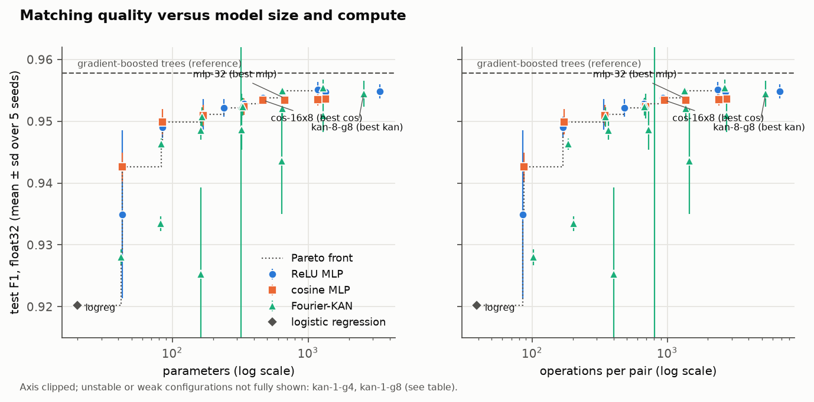

# metriqa-photonic-poc

A reproducible evaluation of photonic-ready neural inference for **entity resolution** (do two
company records describe the same company?) with the
[Q.ANT Native Computing Toolkit](https://github.com/Q-ANT-GmbH/qant_native_computing_toolkit).
Three experiments, 352 trained models, five seeds each, every model executed through the toolkit
and compared with PyTorch.

> **Scope:** all Q.ANT results come from the toolkit's `cpu-backend` **simulator** (noise-free
> bfloat16 on the host). Nothing was run on a physical NPU; there are no speed or energy claims.
> Timings are host measurements; NPU performance appears only in labelled analytical scenarios.

**Read:** [research report](docs/research-report.md) · [one-page summary for Q.ANT](docs/qant-technical-summary.md) ·
[pilot plan](docs/pilot-plan.md) · [toolkit capabilities and limits](docs/sdk-capabilities.md) ·
[upstream issue drafts](docs/upstream-issues.md) · [all numbers](results/research/)

## Findings

| | Question | Answer (simulator, 13,500 test pairs, 5 seeds) |
|---|---|---|
| A | Do architectures built on the NPU's native cosine need fewer parameters than ReLU MLPs? | **No.** Cosine MLPs and Fourier-KAN networks match MLPs at every size; no difference is significant. The Fourier advantage from periodic-function demos does not transfer to tabular matching. |
| A | Can a KAN layer be executed better? | **Yes.** A Fourier-KAN layer is exactly a fixed Fourier basis plus one matrix product. Executed that way it runs 95–97% of its operations on the NPU (toolkit call: 52%), moves up to half as much data and is more accurate than PyTorch bf16. |
| B | Does bf16 execution change decisions? | **Barely.** 0.03–0.06% of MLP decisions and ~0.15% of KAN decisions flip, only within a narrow margin band; calibration and high-precision operating points are unchanged; depth does not matter. |
| B | Any toolkit defects? | `calc_kan_layer_fprop` **accumulates in bf16**: error grows with fan-in and roughly doubles KAN decision flips. Also: `conv` calls accept `dilation`/`output_padding` values they then reject. |
| C | Can offloading speed up compact matching models? | **No, by measurement.** The host work a hybrid pipeline keeps on the CPU already costs as much as the whole CPU inference; feature extraction dominates anyway. Break-even needs layers ≳ 1,000–4,000 wide and an NPU sustaining ≳ 0.5 TOPS. |
| D | Does the cost model hold on a real NPU? | **Yes, on an electronic one** (AMD XDNA 2 in the study laptop, via Windows ML; not Q.ANT hardware). F1 stays within 0.0003 of float32, but each call costs 120–230 µs: compact models are never faster than the CPU; KAN models break even at batches of ≈ 450–3,300. See [docs/amd-npu.md](docs/amd-npu.md). |
| – | What needs hardware? | Real error and cosine shape, decision stability under analog noise, latency and transfer, energy per inference, drift: five experiments with success criteria in the report (§9). |



## What is in the repository

```
src/photonic_poc/
  data/, features.py      synthetic company pairs (deterministic) and 19 generic similarity features
  models.py               logreg, ReLU MLP, cosine MLP, Fourier-KAN, named by labels like mlp-32x16
  hybrid.py, kan_paths.py hybrid CPU/NPU executor with placement policies and per-stage timing
  op_profile.py           static cost model: operations, placement, host<->NPU traffic per sample
  qant_backend.py         run any supported nn.Sequential through the toolkit (simulator or NPU)
  stability.py            decision flips, margins, calibration, high-precision thresholds
  statistics.py           Pareto fronts, paired bootstrap
  numpy_forward.py        framework-free CPU baseline
  experiments/            A: architecture, B: robustness, C: hybrid cost, D: AMD NPU (configs/research.toml)
  onnx_export.py, amd_npu.py  ONNX export; AMD Ryzen AI NPU via Windows ML (optional extra)
  private_eval.py         evaluate private models locally; publish only approved aggregates
  figures/                report figures
examples/                 hybrid inference walkthrough; minimal upstream reproductions
configs/                  research.toml (published results), quick.toml (CI)
results/                  research/ (JSON + figures), RESULTS.md (original proof of concept)
```

Reusable pieces: `HybridExecutor` (any `nn.Sequential` of Linear/ReLU/Sigmoid/Cos/FourierKAN, five
placement policies), `profile_model` (works without the toolkit), `decision_stability` (any pair of
logit vectors), `run_benchmark` (any model and feature matrix), `paired_bootstrap_f1`.

## Setup

Requires [uv](https://docs.astral.sh/uv/) on Linux x86_64, Windows x86_64 or macOS arm64 (the
platforms of the toolkit's simulator wheel).

```bash
uv sync                                       # dependencies, CPU-only PyTorch
uv run python scripts/install_qant_sdk.py     # official toolkit wheel, pinned v2.5.0 + SHA-256
uv run photonic-poc sdk-info                  # toolkit version, driver, simulated NPUs
```

`uv sync` removes packages that are not in the lock file, including the toolkit. Re-run the install
script after `uv sync`; `uv run` keeps it. For hardware, see [docs/hardware.md](docs/hardware.md).

## Reproduce

```bash
uv run photonic-poc research                       # experiments A, B, C + figures (~15 min, 14 cores)
uv run photonic-poc research --only robustness     # one experiment (reuses cached models)
uv run photonic-poc figures                        # re-render figures from results/research/*.json
uv run python examples/hybrid_inference.py         # hybrid inference walkthrough
uv run photonic-poc research --only amd-npu        # Experiment D, Windows + AMD Ryzen AI NPU only
```

Experiment D needs the optional extra (`uv sync --extra amd-npu --inexact`) and Windows ML's VitisAI
execution provider; see [docs/amd-npu.md](docs/amd-npu.md).

Training jobs run single-threaded and are cached under `artifacts/`, so results do not depend on
the number of workers and re-runs skip finished work. Host timings depend on the machine and its
load. The original proof of concept is still available: `uv run photonic-poc reproduce` →
[results/RESULTS.md](results/RESULTS.md).

## Private evaluation

Proprietary models and data stay private: `photonic-poc private-eval` runs the analyses locally,
refuses to write into this repository and produces a whitelisted aggregate summary that can be
published only after `photonic-poc approve-summary`. See
[docs/private-integration.md](docs/private-integration.md).

## Tests and CI

```bash
uv run pytest                   # toolkit tests skip if the toolkit is missing
uv run ruff check . && uv run mypy
```

GitHub Actions runs lint, type checks and all tests, including the research pipeline on a tiny
configuration, on Linux, Windows and macOS with the simulator installed (`REQUIRE_QANT=1`).

## License

Apache-2.0, see [LICENSE](LICENSE). The Q.ANT Native Computing Toolkit is a separate project by
Q.ANT GmbH under its own Apache-2.0 license; it is downloaded at install time, not redistributed.
