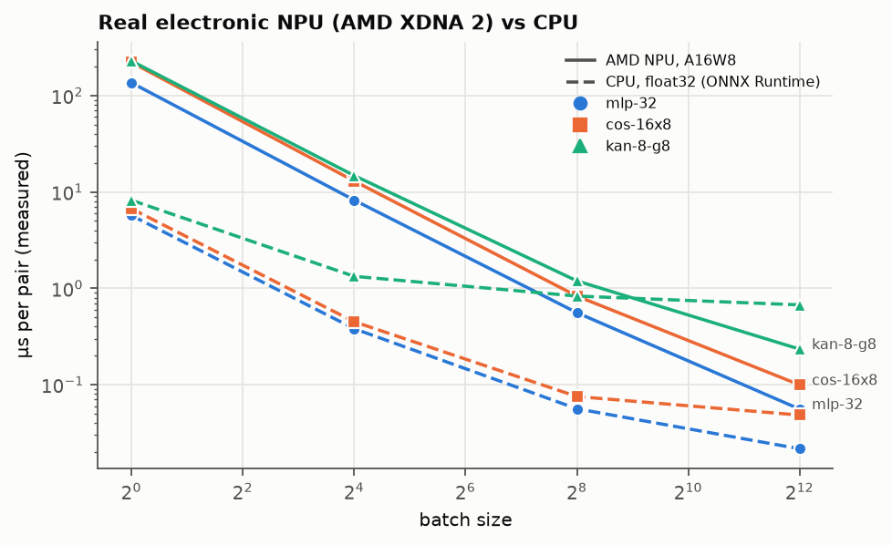

# Experiment D: a real electronic NPU as a reference (AMD Ryzen AI / XDNA 2)

The research experiments run on Q.ANT's simulator. To check the cost structure of Experiment C on
real accelerator hardware, the same trained models also run on the AMD XDNA 2 NPU of a Ryzen AI
laptop through Windows ML. **This is an electronic NPU; nothing here measures Q.ANT hardware.** It
shows how the harness measures a real NPU end to end, and whether per-call overhead behaves as the
cost model predicts.

## Setup (Windows 11, AMD Ryzen AI processor)

```powershell
uv sync --extra amd-npu --inexact            # onnx, onnxruntime-windowsml, Windows App SDK bindings
uv run python scripts/install_qant_sdk.py    # if uv sync removed the toolkit
uv run photonic-poc research --only amd-npu  # needs the models of Experiment A (cached)
```

Windows ML supplies AMD's `VitisAIExecutionProvider` as a separate system package. If it is not
installed yet, the run stops with a message; set `allow_download = true` under `[amd_npu]` in
`configs/research.toml` to let Windows ML download and install it (a system-wide package). Tests
never download it.

## What the pipeline does

1. Export each trained `nn.Sequential` to ONNX with a static batch
   ([`onnx_export.py`](../src/photonic_poc/onnx_export.py)). Fourier-KAN layers are exported in
   their exact factorised form (Gemm → Cos → Gemm), so every model is matrix products plus
   element-wise functions.
2. Quantise to QDQ with uint16 activations and symmetric int8 weights (A16W8), calibrated on 2,048
   training pairs ([`amd_npu.py`](../src/photonic_poc/amd_npu.py)).
3. Run all 13,500 test pairs on the NPU and, as controls, the same quantised model and the float32
   model on ONNX Runtime's CPU execution provider; read operator placement from the provider's log.
4. Time one call per batch size (median) on NPU and CPU.

## Provider issues found (VitisAI EP 2.1000.81 via Windows ML, ONNX Runtime 1.25.2)

1. **Float32 models crash the process.** For non-quantised models the provider compiles on the fly
   (float → bf16). From an unpackaged Python process the compiler is passed a truncated path,
   `-load-vfs C:\PROGRA~1\WindowsApps\`, fails to load ("Failed to load VFS"), and the provider
   then terminates the whole process (exit code 127). Quantised (QDQ) models take a different path
   and compile in under 0.1 s.
2. **Wrong results for single-column outputs at batch > 1.** A QDQ model whose last layer has one
   output column returns wrong values at batch 256 (correlation −0.01 with the CPU result; only the
   first row is right), while batch 1 and outputs with ≥ 8 columns are exact. The exporter
   therefore pads the output layer to 8 zero columns and reads column 0.

Both were observed on one machine with NPU driver 32.0.20102.4480; they are reported here, not
upstream.

## Results (one run, `photonic-poc research --only amd-npu`, 13,500 test pairs, 5 seeds)

Full data: [`results/research/amd_npu.json`](../results/research/amd_npu.json).

**Accuracy (mean over 5 seeds).** Every operator except the final output dequantisation runs on the
NPU, including `Cos`.

| model | F1 float32 | F1 AMD NPU | flips NPU vs float32 | flips Q.ANT simulator (bf16) | rel. RMS Δlogit NPU | NPU = quantised model on CPU? |
|---|---|---|---|---|---|---|
| logreg | 0.9202 | 0.9202 | 21.6 (0.16%) | 10.6 (0.08%) | 0.96% | yes (max Δ 0.0003) |
| mlp-8x8 | 0.9521 | 0.9519 | 26.6 (0.20%) | 7.8 (0.06%) | 1.23% | yes (max Δ 0.0005) |
| mlp-32 | 0.9537 | 0.9538 | 10.2 (0.08%) | 3.4 (0.03%) | 0.74% | yes (max Δ 0.0004) |
| cos-16 | 0.9523 | 0.9523 | 11.2 (0.08%) | 5.2 (0.04%) | 0.85% | no (max Δ 0.12) |
| cos-16x8 | 0.9534 | 0.9535 | 12.6 (0.09%) | 4.4 (0.03%) | 0.94% | no (max Δ 0.15) |
| kan-4-g2 | 0.9524 | 0.9522 | 22.4 (0.17%) | 20.6 (0.15%) | 1.45% | no (max Δ 0.23) |
| kan-8-g8 | 0.9545 | 0.9542 | 27.6 (0.20%) | 20.0 (0.15%) | 1.54% | no (max Δ 0.18) |

- F1 stays within 0.0003 of float32 for every model (H_D1 supported).
- 8-bit weights flip 2–3.4× as many decisions as bf16 does for the MLPs and cosine MLPs and about as
  many for the KAN models; at most 0.2% in all cases.
- For ReLU models the NPU reproduces the quantised CPU result exactly. With `Cos` the NPU differs by
  up to 0.23 in logit: it evaluates the cosine with its own approximation. Decisions are barely
  affected — a small, real instance of the "hardware cosine shape" question for photonic NPUs.

**Latency (median per call, seed 0).** A two-point fit of time per call = fixed + per-pair × batch
(batches 1 and 4,096):

| model | NPU fixed µs/call | NPU µs/pair | CPU fixed µs/call | CPU µs/pair | NPU ÷ CPU at 256 | NPU ÷ CPU at 4,096 | break-even batch |
|---|---|---|---|---|---|---|---|
| logreg | 124 | 0.021 | 4.8 | 0.006 | 25.4× | 6.7× | never |
| mlp-8x8 | 141 | 0.027 | 6.1 | 0.016 | 15.4× | 3.5× | never |
| mlp-32 | 136 | 0.023 | 5.7 | 0.020 | 9.9× | 2.6× | never |
| cos-16 | 174 | 0.034 | 6.0 | 0.032 | 14.0× | 2.3× | never |
| cos-16x8 | 221 | 0.045 | 6.7 | 0.047 | 11.0× | 2.1× | ≈ 170,000 |
| kan-4-g2 | 216 | 0.080 | 7.3 | 0.143 | 5.6× | 0.92× | ≈ 3,300 |
| kan-8-g8 | 228 | 0.178 | 7.5 | 0.671 | 1.4× | 0.35× | ≈ 450 |

CPU = the float32 model on ONNX Runtime's CPU execution provider (all threads).



- Each NPU call costs 120–230 µs before any work is done, 20–30× the CPU's call overhead.
- For logistic regression, MLPs and cosine MLPs the NPU's marginal cost per pair is no lower than the
  CPU's, so batching never amortises the fixed cost (H_D2 supported).
- Only the KAN models, with hundreds of cosines per pair, have a lower marginal cost on the NPU
  (1.8–3.8×); they break even at batches of ≈ 450 (`kan-8-g8`) and ≈ 3,300 (`kan-4-g2`).
- This is the structure of the Experiment C cost model, on real hardware: an accelerator helps only
  when its marginal cost per pair is lower than the CPU's *and* the batch amortises the fixed cost.

**Caveats.** One run on a shared laptop; an earlier exploratory run gave the same pattern with
absolute timings up to ~2× different (and one transient 2.3 ms outlier). A16W8 integer quantisation
is not bf16, so accuracy differences mix quantisation and hardware. Power was not measured. Nothing
here transfers numerically to Q.ANT's photonic NPU; the point is that the harness measures a real NPU
end to end and that the cost structure is as predicted.
