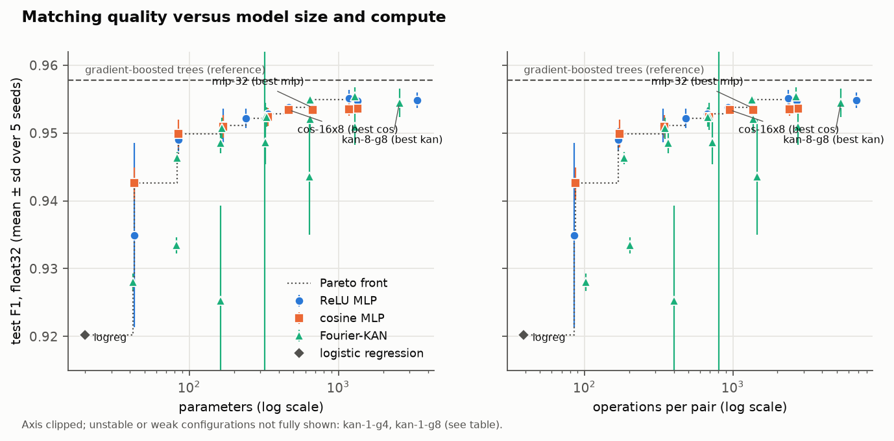
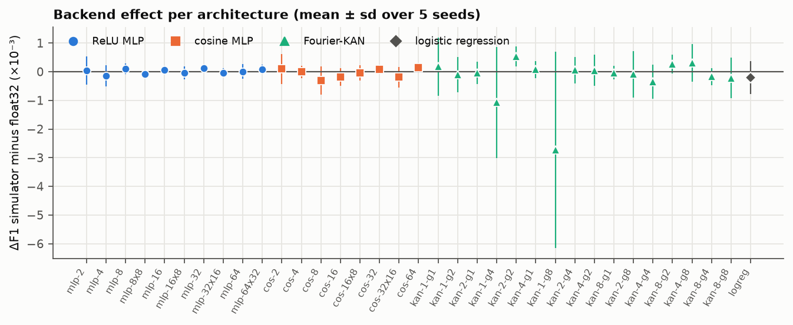
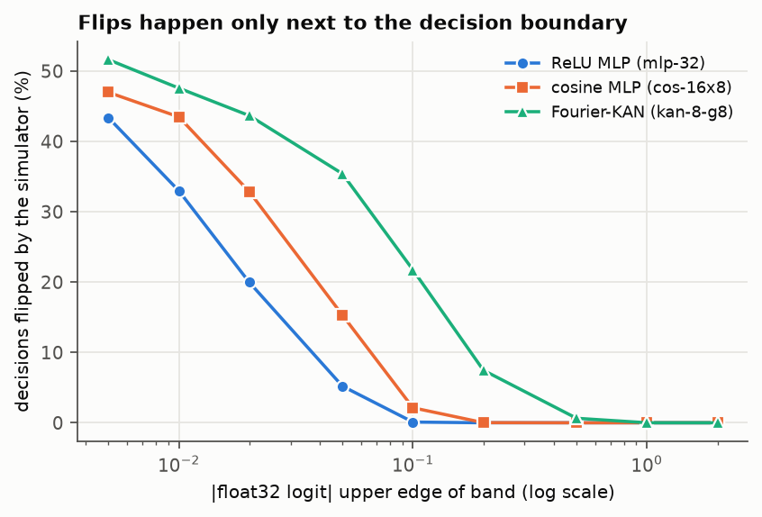
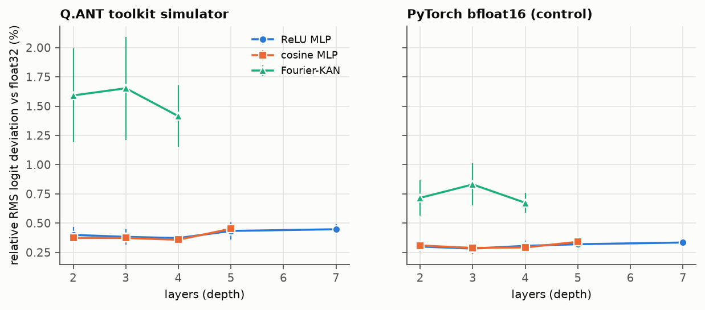
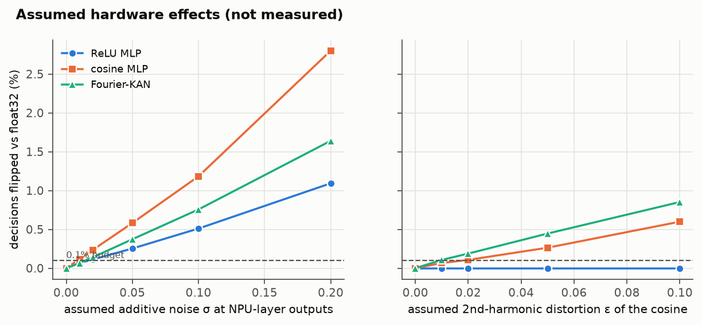
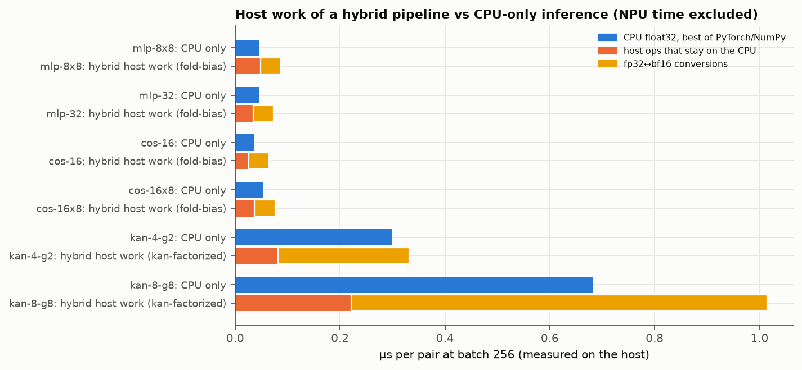
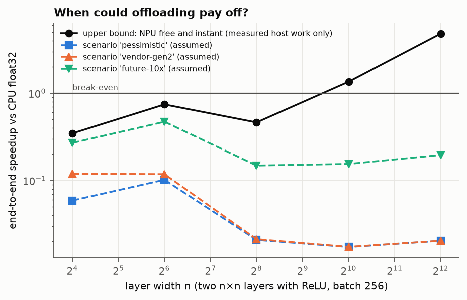

# Photonic-ready entity matching: an evaluation with the Q.ANT Native Computing Toolkit

Metriqa GmbH · November 2026 · toolkit v2.5.0 (`cpu-backend` simulator) · code and data:
this repository · every number below is produced by `photonic-poc research` with
[`configs/research.toml`](../configs/research.toml) and stored in [`results/research/`](../results/research/).

> **Scope of evidence.** All Q.ANT results are from the toolkit's CPU simulator, a noise-free
> bfloat16 emulation. No physical NPU was used. Timing results are host measurements; NPU
> performance appears only in clearly labelled analytical scenarios. Vendor figures are quoted as
> vendor claims.

## Executive summary

We built and ran three experiments on a realistic entity-resolution workload (deciding whether two
company records describe the same company) with the official Q.ANT Native Computing Toolkit and its
CPU simulator: 352 trained models, 5 seeds each, 13,500 test pairs.

- **Architecture (Experiment A): no free lunch.** Cosine MLPs and Fourier-KAN networks, which use the
  NPU's native nonlinearity, match ReLU MLPs at every model size but do not beat them (every paired
  difference between the families is within ±0.003 F1 and every 95% interval includes zero). Q.ANT's "~16× fewer parameters"
  result for Fourier layers on a periodic function does not transfer to tabular matching. The
  simulator does not change this conclusion (rank correlation 0.996 with float32).
- **A better way to execute KAN layers.** A Fourier-KAN layer is exactly a fixed Fourier basis followed
  by one matrix product. Executed that way on toolkit primitives, it puts 97% instead of 52% of the
  layer's operations on the NPU, cuts bus traffic by up to half and is more accurate than PyTorch
  bfloat16.
- **Numerics (Experiment B): decisions are stable in the simulator.** bf16 execution flips 0.03–0.06%
  of MLP decisions and ~0.15% of KAN decisions; calibration and precision at 99–99.9% precision
  thresholds are unchanged. Flips are confined to a narrow margin band and explained by margin alone,
  not by how hard a pair is. Deviation does not grow with depth.
- **Toolkit defect found.** `calc_kan_layer_fprop` sums in bfloat16; its error grows with fan-in (up
  to 3.5–3.8%) and roughly doubles the decision flips of KAN models. A float32 sum or the factorised
  execution removes it. Minimal reproductions are drafted for upstream.
- **Hybrid inference (Experiment C): no speedup for compact models, by measurement.** The host work a
  hybrid pipeline leaves on the CPU (bias, ReLU, bf16 conversions, call overhead) already costs as much
  as or more than the whole CPU inference, so even an infinitely fast NPU could not help; feature
  extraction dominates the application anyway. Offloading can pay off only for layers of width
  ≳ 1,000–4,000 and an NPU sustaining ≳ 0.5 TOPS.
- **What only hardware can answer:** real error and `tcos` shape (KAN accuracy is sensitive to it),
  decision stability under analog noise, true latency and transfer costs, energy per inference and
  drift. Five experiments with hypotheses and success criteria are specified (§9); a four-week pilot
  plan is in [pilot-plan.md](pilot-plan.md). The harness runs unchanged on hardware.

## 1. Motivation: entity resolution as a photonic workload

Entity resolution decides whether two records describe the same real-world entity. Metriqa matches
company records across sources (registers, directories, websites) at scale: every new record is
compared with candidate records, and each comparison is a small neural inference on a vector of
similarity features. The workload is high-volume, latency-tolerant, dominated by small dense layers
and smooth nonlinearities, and quality-critical at high-precision operating points, because a false
merge of two companies is expensive. That makes it a plausible, but not obvious, candidate for
photonic inference: the arithmetic is cheap per pair, so any hardware benefit must survive the
surrounding host work.

All experiments use a public, fully synthetic stand-in for this task: 15,000 generated companies
(syllable-built names, synthetic addresses and contacts, sister companies, shared business-centre
addresses) give 27,000 / 4,500 / 13,500 train / validation / test pairs, one third matches, split by
company family so no entity leaks across splits. Each pair becomes 19 generic similarity features in
[0, 1]. The private evaluation path (§8) runs the same analyses on proprietary models and data
without exposing them.

## 2. The Q.ANT toolkit and what runs where

Findings from the toolkit source (commit `09d8b70`), its examples and public statements; details in
[sdk-capabilities.md](sdk-capabilities.md).

- **Data type.** Every operation takes and returns bfloat16 (8-bit mantissa). There is no float32 path.
- **Forward only.** All AI operations are `*_fprop`; models are trained elsewhere.
- **What the NPU executes.** The driver receives matrix-vector products (`linear_fprop`, with an
  optional device-memory path for weights), element-wise products and the periodic nonlinearity
  `tcos(u)·v` (Gen 2), and the DFT (Gen 2+ / "Gen2p"). ReLU, sigmoid, softmax, bias addition and
  pooling are computed by the toolkit on the host, also when hardware is attached. A maintainer
  confirmed this publicly (toolkit discussion #11: "only the matrix multiplications run on the
  card"; "the PCIe bus is currently the bottleneck").
- **Hybrid calls.** `calc_kan_layer_fprop` (a Fourier-KAN layer) performs `k·x` and `a·tcos(·)` on
  the NPU but the phase addition and the sum over inputs and frequencies on the host, in bf16.
- **Chaining.** Only the matrix product can keep inputs and outputs in device memory. Every other
  NPU call takes host arrays and returns host arrays.
- **Simulator.** The CPU backend is noise-free, uses an exact cosine (hardware: an unspecified
  "cosine-like" `tcos`), rounds each product of a matrix-vector product to bf16 before a float32
  accumulation, and has no timing model.
- **Hardware (vendor claims, not verified).** Gen 2 is a thin-film lithium niobate processor on a
  PCIe card in a rack server, quoted at 8 GOPS (operations "more complex than multiply-accumulates"),
  about 150 W and 8 parallel channels, with "up to 30x lower energy use and 50x higher performance"
  for selected workloads (EE Times, 2025-11-26; Quantum Insider, 2025-11-19). No public paper reports
  its precision or noise.

**Existing demonstrations** (examples repository): MNIST MLP, ResNet-18, UNet, DFT denoising, a
tiny language model, parallel matrix products, and a Fourier-vs-MLP comparison on a 1-D periodic
function where the Fourier network wins with ~16× fewer parameters. None covers tabular
classification, decision stability, calibration, multi-seed size/quality trade-offs or hybrid
cost accounting. Those are the subject of this report.

## 3. Methodology

**Models.** Four families, all `nn.Sequential` models that map onto toolkit calls:
logistic regression; ReLU MLPs (1–2 hidden layers, widths 2–64); cosine MLPs (the same, with
`cos` activations, i.e. the NPU's native nonlinearity); and Fourier-KAN networks (one hidden layer
of 1–8 units, 1–8 frequencies per connection), exactly the form of `calc_kan_layer_fprop`.

**Training budget.** Identical for every model: Adam, batch 256, 60 epochs, weight decay 1e-4,
checkpoint at the lowest validation loss. The learning rate is chosen per architecture from the same
grid {1e-3, 3e-3, 1e-2, 3e-2} on validation loss (seed 0), then 5 seeds are trained. 280 trainings
for Experiment A, 72 more for the depth study; each trains single-threaded, so results do not depend
on parallelism.

**Evaluation.** Test F1, precision, recall and ROC AUC at probability 0.5 on 13,500 pairs; every
model on PyTorch float32 (reference), PyTorch bfloat16 (precision control) and the toolkit simulator.
"Best" and "compact" models per family are selected on **validation** F1, never on test. Differences
are tested with a paired bootstrap over test pairs (2,000 resamples, seed-averaged F1). Costs are
counted statically per pair: a multiply-accumulate is 2 operations, an element-wise function or
multiply/add 1 ([`op_profile.py`](../src/photonic_poc/op_profile.py)).

**Reproduction.** `uv run photonic-poc research` (≈ 15 minutes on 14 cores for the first run; trained
models are cached) regenerates every JSON file and figure. A tiny configuration runs in CI.

## 4. Experiment A: architecture efficiency

**Hypothesis H_A.** Architectures built on the NPU's native nonlinearity (cosine MLP, Fourier-KAN)
reach the test F1 of ReLU MLPs with fewer parameters or operations. *Falsified if* MLPs reach every
quality level at equal or lower cost, or if differences vanish within seed and sampling noise.

**Baselines.** Logistic regression (lower bound) and scikit-learn gradient-boosted trees (a strong
non-neural reference for these features, not NPU-executable).



**Smallest model per family within a margin of the best mean test F1 (0.9554)** (float32):

| within | ReLU MLP | cosine MLP | Fourier-KAN |
|---|---|---|---|
| 0.002 | 465 params / 929 ops | 465 / 953 | 649 / 1,343 |
| 0.005 | 169 / 337 | 169 / 345 | 165 / 348 |
| 0.010 | 85 / 169 | 85 / 173 | 83 / 184 |

**Validation-selected models, test F1 (mean ± sd over 5 seeds):**

| model | params | ops/pair | test F1 | precision | recall |
|---|---|---|---|---|---|
| logistic regression | 20 | 39 | 0.9202 ± 0.0006 | 0.932 | 0.909 |
| best ReLU MLP `mlp-32` | 673 | 1,345 | 0.9537 ± 0.0011 | 0.956 | 0.951 |
| best cosine MLP `cos-16x8` | 465 | 953 | 0.9534 ± 0.0007 | 0.952 | 0.955 |
| best Fourier-KAN `kan-8-g8` | 2,569 | 5,345 | 0.9545 ± 0.0021 | 0.956 | 0.953 |
| compact ReLU MLP `mlp-8x8` | 241 | 481 | 0.9521 ± 0.0014 | 0.952 | 0.953 |
| compact cosine MLP `cos-16` | 337 | 689 | 0.9523 ± 0.0013 | 0.958 | 0.947 |
| compact Fourier-KAN `kan-4-g2` | 325 | 691 | 0.9524 ± 0.0020 | 0.954 | 0.951 |
| gradient-boosted trees (reference) | – | – | 0.9578 ± 0.0003 | | |

**Paired bootstrap, ΔF1 (95% interval):** best KAN − best MLP +0.0007 [−0.0012, +0.0028]; best
cosine − best MLP −0.0003 [−0.0019, +0.0011]; compact KAN − compact MLP +0.0003 [−0.0012, +0.0020];
compact cosine − compact MLP +0.0002 [−0.0013, +0.0018]; best MLP − logistic regression +0.034
[+0.029, +0.039]. The simulator gives the same signs and intervals within 0.0004.

**Result: H_A is not supported.** At every quality level the three families need essentially the
same number of parameters and operations, and no pairwise difference is distinguishable from
noise. All neural families stay about 0.003 below the tree ensemble. The ~16× parameter advantage
of Fourier layers in Q.ANT's periodic-function demo does not carry over to this tabular task, whose
decision function is not periodic.

**Architecture or backend?** Ranking architectures by simulator F1 instead of float32 F1 gives a
Spearman correlation of 0.996; the largest seed-mean ΔF1 of any architecture is 0.0027 (an
unstable configuration), typically < 0.0005 (figure below). The Pareto fronts by parameter count
differ only in one member. Whatever differences exist are architectural, not caused by the backend.



**Costs that favour MLPs.** Fourier-KAN models train 2.6× slower per epoch budget (23 s vs 9 s on
one core), are unstable when narrow with many frequencies (`kan-1-g8`: F1 0.90 ± 0.07), and deviate
3–5× more from float32 on the simulator (mean relative RMS logit deviation 1.8% vs 0.4%, see §5).

**Why the families tie: a KAN layer is a cosine network with a fixed first layer.** The identity
`a·cos(kx + φ) = (a cos φ)·cos(kx) − (a sin φ)·sin(kx)` rewrites every Fourier-KAN layer as a fixed
Fourier-feature map `[cos(k_l x_i), sin(k_l x_i)]` followed by one learned linear layer. A cosine MLP
learns that first layer instead. Both are therefore linear models over periodic features, which
explains their similar behaviour on this task. The identity also yields a better way to *execute*
KAN layers on the NPU (§6).

**Limitations.** One synthetic dataset and feature set; tabular features in [0, 1] (where per-feature
nonlinear transforms help any model); learning rates tuned on a coarse grid with one seed; model sizes
up to ~3,400 parameters.

## 5. Experiment B: numerical robustness and decision stability

**Hypotheses.** *H_B1:* the simulator flips < 0.5% of decisions for every studied model, and flips
occur only within a narrow margin band around the threshold. *H_B2:* ambiguous pair kinds flip more
often only because their pairs lie closer to the boundary. *H_B3:* calibration (ECE) changes by
< 0.005 and precision at float32-tuned high-precision thresholds by < 0.002. *H_B4:* logit deviation
grows with depth, faster for KAN than for MLP.

**Setup.** The validation-selected models of Experiment A plus `mlp-32x16` and `kan-4-g4`, 5 seeds
each, 13,500 test pairs. Reference: PyTorch float32; control: PyTorch bfloat16. Additional probes:
20,000 off-manifold inputs (every feature uniform on [0, 1]) and 20,000 points bisected onto each
model's decision boundary. A depth series trains widths 16 (MLP, cosine) and 4 (KAN) with 1–6
hidden layers under the same protocol.

**Decision flips and deviation (toolkit simulator vs float32, mean over 5 seeds):**

| model | test F1 | rel. RMS Δlogit | 99.9th pct \|Δlogit\| | flips / 13,500 | ΔECE | flips with float32 sum or factorised KAN |
|---|---|---|---|---|---|---|
| logistic regression | 0.9202 | 0.48% | 0.070 | 10.6 (0.08%) | +0.0002 | 4.2 (host float32) |
| `mlp-32` | 0.9537 | 0.35% | 0.092 | 3.4 (0.03%) | +0.0000 | 3.0 (host float32) |
| `mlp-8x8` | 0.9521 | 0.43% | 0.115 | 7.8 (0.06%) | +0.0002 | 4.4 (host float32) |
| `cos-16x8` | 0.9534 | 0.40% | 0.091 | 4.4 (0.03%) | +0.0002 | 4.0 (bias folded) |
| `kan-8-g8` | 0.9545 | 1.89% | 0.506 | 20.0 (0.15%) | +0.0001 | 11.2 (float32 sum) / **3.6** (factorised) |
| `kan-4-g4` | 0.9521 | 1.59% | 0.357 | 21.6 (0.16%) | +0.0003 | 8.2 / **5.4** |
| `kan-4-g2` | 0.9524 | 1.02% | 0.252 | 20.6 (0.15%) | −0.0003 | 11.0 / **9.0** |



**H_B1 supported.** No model flips more than 0.16% of decisions; MLPs and cosine MLPs flip
0.03–0.06%. On the boundary probe, flip probability falls from 43–52% at |logit| < 0.005 to zero
beyond |logit| ≈ 0.1–0.2 for MLP and cosine models, and beyond ≈ 0.5 for KAN models (figure). Those
bands hold 0.33–0.61% (|logit| < 0.1) and 1.6–3.6% (|logit| < 0.5) of test pairs. Off-manifold inputs raise
deviation 1.2–1.9× and flip rates 3–5×, so inputs unlike the training data are more fragile.

**H_B2 supported.** Per-kind flip rates differ by orders of magnitude (sister companies and legal-form
changes flip most; random pairs never), yet observed counts match those expected from each kind's
margins alone (χ² between 0.6 and 4.7 on 4–5 degrees of freedom for all nine models). Difficulty
matters only through the margin it produces.

**H_B3 supported, with a caveat.** |ΔECE| ≤ 0.0003 and |ΔBrier| ≤ 0.0001 for every model. At
thresholds tuned on validation for precision 0.99 / 0.995 / 0.999, test precision changes by at most
0.0003 and false-positive counts by at most 3 per 5 × 13,500 pairs. *But* individual decisions churn
2–3× more there than at 0.5 (e.g. `kan-4-g4`: 274 vs 108 flips over 5 seeds at precision 0.99),
because 1.3–2.8× more pairs lie within ±0.05 of those thresholds than around 0.5, while the absolute
deviation does not depend on the logit's magnitude. Flips in both directions cancel in the aggregate.
A deployment that audits individual high-precision decisions would see this churn.

**H_B4 rejected.** Deviation does not grow with depth: 0.40% → 0.45% from 2 to 7 layers (MLP),
0.37% → 0.45% from 2 to 5 (cosine), 1.59% → 1.41% from 2 to 4 (KAN). The PyTorch-bf16 control is
equally flat. Trained networks at this width do not amplify bf16 errors.



**Where the simulator's error comes from, and fixes.** For MLPs, the toolkit's rounding of every
product to bf16 adds about a third to the PyTorch-bf16 deviation (0.35% vs 0.26% for `mlp-32`).
Running bias and ReLU on the host in float32 or folding the bias into the matrix product removes
part of it (0.28%). For KAN models the toolkit's bf16 accumulator dominates: deviation is 1.6–3.0×
the PyTorch-bf16 control. Summing in float32 brings it to the control level (0.55–0.61%), and the
factorised execution (§6) goes below it (0.43–0.46%, the MLP level), with 2.3–5.6× fewer flips.
Wrapping phases into [−π, π) changes nothing: trained phases never exceeded |φ| = 2.11.

**What the simulator cannot tell us: assumed hardware effects.** Two explicitly assumed
perturbations, applied in float32 (not measurements):



- *Additive Gaussian noise* at every NPU call's output. To keep flips ≤ 0.1%, σ must stay at about 0.01–0.02
  for MLPs and at or below 0.01 for KAN and cosine models (`cos-16x8` and `kan-4-g4` already exceed
  0.1% at σ = 0.01; these models have more NPU calls, hence more noise sites). Aggregate F1 tolerates
  much more: |ΔF1| ≤ 0.002 holds up to σ = 0.1 for MLPs but only to σ ≈ 0.02 for `kan-4-g4`
  (−0.0021 at σ = 0.05). Noise-aware training is therefore worth testing on hardware.
- *Cosine shape:* replacing cos u by (cos u + ε cos 2u)/(1 + ε). ReLU MLPs are unaffected (control).
  Cosine MLPs flip 0.06–0.65% of decisions for ε = 0.01–0.1 but keep F1 within 0.0005. KAN models
  lose up to 0.017 F1 at ε = 0.1 (`kan-4-g2`) and 0.003 already at ε = 0.05 (`kan-4-g4`): summing
  hundreds of distorted cosine terms accumulates the error. Whether a KAN model trained against an
  exact cosine transfers to hardware depends on how close `tcos` is to a cosine. This must be
  measured (§9, H1).

**Limitations.** Seven models of up to ~2,600 parameters; one dataset; the assumed noise and
distortion models are illustrative, not derived from hardware; the simulator's NPU numerics are
those of its CPU emulation.

## 6. Experiment C: hybrid CPU/NPU inference

**Hypotheses.** *H_C1:* for the compact matching models, the work that stays on the CPU in a hybrid
pipeline (toolkit host operations, fp32↔bf16 conversions, per-call overhead) already costs more than
the whole CPU-only inference, so no NPU speed can produce an end-to-end gain. *H_C2:* an advantage
needs layers wide enough that the matrix work removed from the CPU outweighs that host work; we
locate this width analytically from measured host costs and explicitly assumed NPU parameters.

### 6.1 A modular hybrid executor

[`HybridExecutor`](../src/photonic_poc/hybrid.py) compiles an `nn.Sequential` into stages, each
placed on the NPU (a toolkit call the driver executes) or the host, and inserts explicit conversion
stages wherever the dtype changes, so every cost is visible. Placement policies:

| policy | what changes | why |
|---|---|---|
| `toolkit` (default) | exactly what the toolkit does on its own | baseline; `QantBackend` uses it |
| `fold-bias` | bias becomes an extra weight column (the input gets a constant 1) | moves bias additions onto the NPU |
| `host-fp32` | bias/ReLU/sigmoid in NumPy float32 instead of toolkit bf16 | precision, at the cost of extra conversions |
| `kan-native` | the toolkit's KAN math from NPU primitives, summed in float32 | fixes the bf16 accumulator |
| `kan-factorized` | Fourier basis on the NPU + one preloaded matrix product (§4 identity) | all arithmetic on the NPU, float32 accumulation |

The same code runs unchanged on hardware. [`op_profile.py`](../src/photonic_poc/op_profile.py) gives
the static cost of any model under any policy without the toolkit; the
[hybrid inference example](../examples/hybrid_inference.py) walks through both.

**What is eligible for the NPU (per pair):**

| model | policy | NPU share of ops | NPU calls | elements over the bus | NPU ops per element moved |
|---|---|---|---|---|---|
| `mlp-32` | toolkit | 95.2% | 2 | 84 | 15.2 |
| `mlp-32` | fold-bias | 97.7% (ReLU stays) | 2 | 86 | 15.7 |
| `cos-16x8` | fold-bias | **100%** | 5 | 143 | 6.8 |
| `kan-8-g8` | toolkit | 51.9% | 4 | 4,488 | 0.6 |
| `kan-8-g8` | factorised | **96.6%** | 6 | 2,387 | 2.6 |

Arithmetic is easy to offload. Data movement is not: every NPU call except the preloaded matrix
product returns to the host, and the toolkit's KAN call ships its full term tensor (n_out·n_in·n_k
elements, twice) to the device and back.

### 6.2 Measured host costs (representative of a hardware run)

These run the same host code with or without an NPU (toolkit v2.5.0, NumPy, ml_dtypes):

| quantity | measured |
|---|---|
| fp32 → bf16 conversion (ml_dtypes) | 1.3–1.5 ns per element |
| bf16 → fp32 conversion | 0.2–0.6 ns per element |
| toolkit `relu_fprop` (host, bf16) | 0.25–0.77 ns per element (NumPy fp32: 0.41–0.67) |
| toolkit `add_bias_fprop` (host, bf16) | 2.4–2.7 ns per element |
| per toolkit NPU call on the simulator (Python wrapper, checks, FFI; **lower bound**) | 1.5–2.8 µs |
| PyTorch `nn.Linear(1,1)` call, for comparison | 3.8 µs |
| CPU cosine (NumPy, one core) | 0.85 ns per element |
| CPU dense matrix product (NumPy, 256×1024×1024) | 475 GOPS (MAC = 2 ops) |
| synthetic-pair feature extraction (Python) | 61 µs per pair |

On hardware, driver and PCIe latency add to the per-call figure. Timings come from a shared
16-thread laptop CPU (AMD, Windows 11) with other processes active; two runs differed by up to 2× in
absolute values without changing any conclusion below.

### 6.3 Results



**H_C1 supported.** The CPU reference is the faster of PyTorch and a plain NumPy implementation
(PyTorch eager mode alone costs microseconds per layer call and would otherwise flatter the hybrid
pipeline). At batch 256, the host work of the best hybrid policy is 1.1–4.8× the *entire* CPU-only
inference (upper bound on speedup 0.21–0.90). Over all models, policies and batch sizes 1–4,096 the
bound never exceeds 1.10 (`kan-4-g4`, batch 1). Even a free and infinitely fast NPU could not make
these models meaningfully faster end to end. Larger batches help the CPU more than the hybrid
pipeline: at batch 4,096 the bound falls to 0.03–0.6. For the toolkit's own KAN call the host share
cannot be measured because it happens inside one call; the native and factorised paths expose it.

**The application is dominated by feature extraction.** Computing the 19 string-similarity features
costs 61 µs per pair against ≤ 1.4 µs for any network at batch ≥ 16. With an infinitely fast network
the pipeline would speed up by at most 1.02×.



**H_C2 supported: break-even needs wide layers and a fast NPU.** For a block of two n×n layers with
ReLU (batch 256), measured host work grows linearly with n while CPU work grows quadratically:

| width n | CPU float32 µs/pair | host work µs/pair | speedup bound (free NPU) | NPU rate needed to break even¹ |
|---|---|---|---|---|
| 16 | 0.04 | 0.11 | 0.35 | none possible |
| 64 | 0.30 | 0.41 | 0.74 | none possible |
| 256 | 0.73 | 1.59 | 0.46 | none possible |
| 1,024 | 9.2 | 6.8 | 1.35 | 2.3 TOPS |
| 4,096 | 172 | 36 | 4.8 | 0.50 TOPS |

¹ Scenario "vendor-gen2": 10 µs per call and 16 GB/s effective bandwidth (assumptions, not
measurements); a multiply-accumulate counts as 2 operations. Q.ANT quotes 8 GOPS for Gen 2 without
defining an operation. If an operation were a scalar multiply-accumulate, that rate would be ~60×
below what break-even at n = 4,096 requires and ~60× below this laptop CPU's measured matrix
throughput. Q.ANT also claims large energy advantages, so the public figure evidently counts
operations differently, which is exactly why measured numbers are needed (§9).

**Bottlenecks, in order of impact for this workload:** (1) feature extraction outside the network;
(2) host-resident operations and fp32↔bf16 conversions: the fp32→bf16 conversion alone (1.3–1.5 ns
per element) costs about as much as the CPU spends per activation on the complete inference (≈ 0.9–1.3 ns
for the MLPs at batch 256); (3) no device-resident chaining for non-matrix operations, so each
layer is a host round trip; (4) the toolkit's KAN implementation (term-tensor transfer, host
summation); (5) per-call software overhead (≥ 1.5 µs per call before driver and PCIe).

**Conditions under which an end-to-end advantage becomes plausible:** layers of width ≳ 1,000–4,000,
or equivalent matrix work per call; sustained NPU throughput of 0.5–2 TOPS (counting a
multiply-accumulate as 2 operations) with ≤ 10 µs per call; device-resident activations or fused
linear+nonlinearity calls that remove conversions and host operations; and pipelines whose compute
sits inside the network (for example learned encoders that replace hand-written string features with
large matrix products). Energy per inference may favour the NPU earlier than speed; that can only be
measured.

**Limitations.** Host timings depend on this CPU and on load; the simulator's call overhead is a
lower bound; scenario parameters are assumptions; the layer study uses synthetic weights.

## 7. Private real-world evaluation

The same analyses run on proprietary models and data through
[`photonic_poc.private_eval`](../src/photonic_poc/private_eval.py), documented in
[private-integration.md](private-integration.md):

```
photonic-poc private-eval --model private_pkg.models:build --data /secure/eval.npz --out /secure/out
photonic-poc approve-summary --summary /secure/out/aggregate_summary.json --approved-by "Name" --out approved.json
```

- The model is imported from the caller's environment; data arrives as arrays. Nothing about
  features, architecture or records enters this repository.
- Writing output into the repository is refused. The full report stays in the private directory.
- The aggregate summary is built from a whitelist (rounded F1/precision/recall per backend, ΔF1, flip
  rate, ΔECE, change of the false-positive rate at high-precision thresholds, rounded parameter and
  operation counts) and is marked *not approved*. Publication requires an explicit approval step that
  records the approver, a timestamp and a SHA-256 of the content. Nothing is uploaded, committed or
  pushed automatically.

No private results are included in this report.

## 8. SDK findings and contributions

Draft upstream issues with minimal reproductions are in [upstream-issues.md](upstream-issues.md)
(not filed yet; none duplicates an existing issue or discussion):

1. **Defect:** `calc_kan_layer_fprop` accumulates in bf16 (`src/non_linear.rs`); error grows with
   fan-in (0.7% → 3.5–3.8% relative RMS from 4 to 256 inputs) and affects hardware runs too.
2. **Defect / docs:** `conv_fprop` and `conv_transpose_fprop` accept and document `dilation`, but the
   core rejects any value other than 1.
3. **Docs:** the Python documentation does not say which functions execute on the host; the Rust doc
   comments do.
4. **Feature request:** device-resident chaining (memory-handle variants) for the nonlinearity and
   element-wise operations, or a fused linear+nonlinearity call.
5. **Suggestion:** execute KAN layers as a Fourier basis plus one matrix product (§4 identity):
   lower error than PyTorch bf16, 97% of operations on the NPU, up to half the bus traffic.

## 9. Why physical Q.ANT NPU access is necessary

The simulator answers questions about bf16 arithmetic. It cannot answer the questions that decide
whether photonic inference is useful for this workload. Five experiments need hardware; each is
scripted in this repository and runs unchanged with the hardware wheel.

**H1. Numerical fidelity of the NPU primitives.**
*Hypothesis:* the hardware error of `linear_fprop`, `calc_scaled_periodic_nl_fprop` and
`calc_kan_layer_fprop` exceeds the simulator's bf16 error and has a systematic part (gain, offset,
`tcos` shape) and a random part. *Measurements:* outputs for fixed inputs across fan-in 16–4,096 and
value ranges, 30 repeats each; `tcos(u)` on ≥ 4,096 points per period. *Method:* `photonic-poc
op-numerics` plus repeated calls; fit bias and σ per primitive and magnitude; compare with the assumed
noise and distortion curves of §5. *Success:* an error model with 95% confidence intervals for every
primitive; the measured `tcos` known to within 10⁻³.

**H2. Decision stability of trained matching models on hardware.**
*Hypothesis:* compact MLP and cosine models keep |ΔF1| ≤ 0.005 and flip ≤ 0.5% of decisions; KAN
models trained against an exact cosine degrade unless retrained against the measured `tcos`;
noise-aware training reduces flips. *Measurements:* Experiment B on hardware (ΔF1, flips by margin
and pair kind, ECE, high-precision thresholds) for plain and noise-trained models, toolkit vs
factorised KAN. *Success:* at least one compact model within the bounds on 13,500 test pairs, with
flips confined to the margin band predicted by the H1 error model.

**H3. End-to-end latency, transfer overhead and batch scaling.**
*Hypothesis:* for compact models per-call latency and PCIe transfer dominate; the measured break-even
width matches the §6 cost model within 20%. *Measurements:* latency per call vs size; upload and
download bandwidth through memory handles; per-pair latency for batch 1–65,536; utilisation from
`get_perf_counter` (time-based minus stalling counter, as in Q.ANT's C++ example); scaling across
NPUs and channels. *Success:* a calibrated cost model and a measured break-even width (or evidence
that none exists up to n = 4,096).

**H4. Energy per inference.**
*Hypothesis:* the NPU path uses less energy per pair than the CPU path in the wide-layer regime, but
not for compact models whose cost is host-bound. *Measurements:* wall and board power at steady state,
idle baseline subtracted, for NPU and CPU paths at equal throughput. *Success:* J/pair repeatable
within ±10% over three runs, reported with the measurement method.

**H5. Operational stability and reproducibility.**
*Hypothesis:* outputs drift with temperature and driver recalibration (the toolkit's example device
configuration lists calibration intervals of 3 and 5 minutes), but decisions of compact models stay
stable. *Measurements:* the fixed benchmark every 5 minutes for 8 hours, sensor readings, output drift
and decision changes between runs. *Success:* bounded drift and ≤ 0.1% decision changes between runs.

The [pilot plan](pilot-plan.md) schedules these experiments over four weeks.

## 10. Limitations and open questions

- **Simulator only.** No statement in this report is a hardware measurement.
- **One synthetic workload.** Real record distributions differ; the private path exists to check
  results on real data, but no private results are reported.
- **Small models.** Up to ~3,400 parameters; larger layers only in the analytical layer study.
- **Assumptions.** Noise and cosine-distortion models and all NPU scenario parameters are assumed.
- **Shared timing machine.** Host timings vary with load (up to 2× between runs here).
- **Open:** value-range limits of the optical encoding; the definition behind vendor throughput and
  energy figures; whether Gen 2+ devices combine DFT with matrix and nonlinear operations in one card.

## 11. Implications for photonically accelerated AI

1. **For compact models, numerics are not the obstacle; data movement is.** bf16 execution flips at
   most 0.16% of decisions and leaves calibration intact. What prevents a speedup is host work and
   transfer around tiny matrix products.
2. **Judge architectures by total work and bus traffic, not parameter count.** Fourier-KAN and cosine
   networks match MLPs here but do not beat them; the parameter advantage reported for periodic
   functions does not generalise to tabular decisions.
3. **Execution strategy matters as much as architecture.** The factorised KAN execution turns a
   52%-offloadable, error-prone layer into a 97%-offloadable layer that is more accurate than PyTorch
   bf16. "Fixed periodic features + one matrix product" is a natural photonic design pattern.
4. **Toolkit priorities.** Float32 accumulation everywhere, device-resident chaining and fused
   linear+nonlinearity calls would remove most of the host round trips measured here.
5. **High-precision decisions need a numerical abstention band.** Aggregate precision is stable, but
   decisions within |logit − threshold| < ~0.1 (≈ 0.5 for KAN in bf16) are not; on hardware this band
   must be measured and widened by the noise found in H1.
6. **Where photonic inference could pay off:** wide layers, large batches, learned encoders that move
   application work into matrix products, and energy-bound deployments. That is what the pilot would
   measure.

